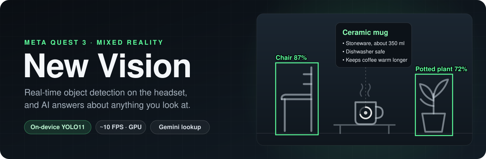
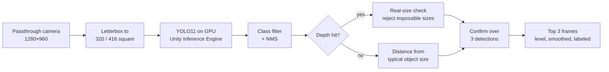
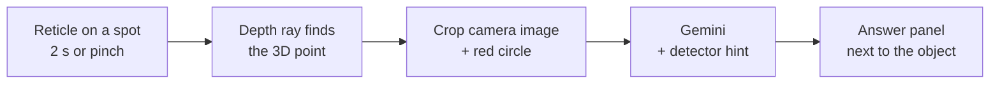

<p align="center">
  
</p>

<p align="center">
  
  
  
  
  
</p>

<p align="center">
  <a href="#features">Features</a> ·
  <a href="#getting-started">Getting started</a> ·
  <a href="#controls">Controls</a> ·
  <a href="#what-is-this-gemini">What is this?</a> ·
  <a href="#models">Models</a> ·
  <a href="#troubleshooting">Troubleshooting</a>
</p>

**New Vision** is a mixed reality app for Meta Quest 3 that sees the world with you. Through passthrough it outlines
objects around you — chairs, tables, plants, people, cars and 70+ more — with crisp, horizon-level frames and labels
like `Chair 87%`, entirely on the headset. And when you want to know more, just look at something: after two seconds
Gemini tells you what it is, even if it's an object the detector has never heard of.

Built on Meta's [Unity-PassthroughCameraApiSamples](https://github.com/oculus-samples/Unity-PassthroughCameraApiSamples)
(`MultiObjectDetection` scene), reworked for speed, accuracy, readability and walking around freely.

## Features

### 🎯 Detection — on the headset, no network needed

- **YOLO11 on the Quest GPU** via Unity Inference Engine, about **10 updates per second**.
- **Switchable models on the fly** — YOLO11n / YOLO11s at 320 or 416 px, picked in the in-headset menu.
- **Choose what to detect** — all 80 COCO classes with presets (all / none / furniture & plants), remembered between launches.
- **Fewer false positives without losing range** — a frame appears only after the object is seen several times in a row,
  and detections with an impossible real-world size (measured with depth) are rejected.
- **Works beyond the depth sensor** — far objects are placed using their typical size, up to 60 m away.

### 💬 "What is this?" — ask AI about anything

- **Look and wait** — keep the reticle on any object for 2 seconds (a ring fills up), or **pinch / pull a trigger** to ask right away.
- **Any object** — not limited to the 80 detected classes: a candy wrapper, a plant species, a gadget, a landmark.
- **Answer next to the object** — name and a few useful facts, streaming in as Gemini writes them, usually in 2–5 seconds.
- **Smart prompt** — Gemini gets a crop around the point you look at, marked with a red circle, plus the detector's guess as a hint.
- **Resilient** — falls back to another model when one is overloaded; uses Google Search grounding when your key allows it.

### 👓 Comfortable to use

- **Calm overlay** — frames only for the **3 most confident** objects at a time.
- **Readable** — sharp frames that stay level with the horizon, smooth motion, labels with the same apparent size at any distance.
- **Reticle at the right depth** — it sits on the surface you look at, so it doesn't double up in your eyes.
- **Walk around freely** — the boundary (Guardian) is hidden while passthrough is on.

## How it works

**Detection** runs continuously on the headset:



**"What is this?"** runs when you ask:



## Requirements

| | |
|---|---|
| Headset | Meta Quest 3 or 3S, Horizon OS v74+, [developer mode](https://developers.meta.com/horizon/documentation/native/android/mobile-device-setup/) enabled |
| Unity | **6000.0.66f2** with *Android Build Support* (OpenJDK, Android SDK & NDK) |
| Git | [Git LFS](https://git-lfs.com/) — the models are stored in LFS |
| For "What is this?" | Internet on the headset and a free [Gemini API key](https://aistudio.google.com/apikey) |
| Optional | Python 3.10+ — `ultralytics` to export more models, plain Python to test a Gemini key |

## Getting started

1. **Clone with LFS**
   ```bash
   git lfs install
   git clone <repository-url>
   ```
   Check that the files in `Assets/PassthroughCameraApiSamples/MultiObjectDetection/SentisInference/Model/` are megabytes,
   not ~130-byte LFS pointers. If they are pointers, run `git lfs pull`.
2. **Open** the project folder in Unity Hub (the first import takes a while).
3. In **File → Build Profiles**, switch to **Android**. The build contains only the `MultiObjectDetection` scene.
4. Run the editor menu items:
   - **New Vision → Apply App Settings** — app name, package id `com.newvision.app`, icon, boundary-visibility support.
   - **New Vision → Convert Models** — converts the ONNX models to Sentis and makes them selectable in the app.
5. Connect the headset over USB and press **Build And Run**.
6. In the headset, allow **camera** and **spatial data** access. If the prompt doesn't appear:
   ```bash
   adb shell pm grant com.newvision.app horizonos.permission.HEADSET_CAMERA
   adb shell pm grant com.newvision.app com.oculus.permission.USE_SCENE
   adb shell pm grant com.newvision.app horizonos.permission.USE_SCENE
   ```
7. *Optional:* [add a Gemini API key](#setting-up-the-key) to enable "What is this?".

Detection starts right away.

## Controls

| Input | Outside the menu | In the menu |
|---|---|---|
| **Look at a spot for 2 s** | "What is this?" for the object under the reticle | — |
| **Trigger** or **index pinch** | "What is this?" right away | toggle the selected row (trigger) |
| **Y** or **☰** (left controller) | open the menu | close the menu |
| **Thumbstick** | — | move up/down; left/right jumps 10 rows |
| **A** / **X** | — | toggle the selected row |
| **B** | — | close the menu |

The menu has a **Model** row (cycles through the models), quick presets, and a checkbox per object class.

The dwell ring starts filling only after half a second, so normal looking around shows nothing — and if it starts
when you didn't mean it, just look away. While you read an answer, looking at the panel never starts a new lookup.
The panel hides itself a couple of seconds after you turn away from it.

## What is this? (Gemini)

When you ask, the headset finds the 3D point under the reticle with the depth sensor, cuts a square around it out of
the camera image (sized to the object if the detector has a frame there), marks the point with a red circle and sends
it to [Gemini](https://ai.google.dev/) together with the detector's guess. The answer streams into a panel next to the object.

Every lookup is a fresh request — there is no cache, because the same spot can hold a different object a moment later.

### Setting up the key

1. Create a free API key in [Google AI Studio](https://aistudio.google.com/apikey).
   A Gemini app subscription (Gemini Pro / Advanced) is *not* needed and does not include API access.
2. Save it as a text file named `gemini_api_key.txt` **outside the repository**.
3. Install the app once, then copy the key to the headset:
   ```bash
   adb push gemini_api_key.txt /sdcard/Android/data/com.newvision.app/files/gemini_api_key.txt
   ```
   The key lives only on the headset — it is not built into the APK and never committed (`gemini_api_key.txt` is in
   `.gitignore`). It survives reinstalls from Unity; uninstalling the app deletes it.
4. To check a key from the PC first: `python Tools/test_gemini.py path/to/gemini_api_key.txt [image]` (the key is never printed).

### Models and cost

| | |
|---|---|
| Main model | `gemini-3.5-flash-lite` — fast, answers in ~2–4 s |
| Fallback | `gemini-3.8-flash` — used automatically when the main model is overloaded (HTTP 5xx) |
| Google Search grounding | on when the key has quota for it (paid plan); without it the app notices the quota error once and answers from the model's own knowledge |
| Cost | a free-tier key is enough for personal use; see [Gemini API pricing](https://ai.google.dev/gemini-api/docs/pricing) |

Models and timings are set in `ObjectInfoLookup.cs` (`m_model`, `m_fallbackModel`, `m_dwellSeconds`, …).

> [!NOTE]
> **Privacy:** for each lookup a 512×512 crop of the camera image is sent to Google's servers. Nothing is sent unless
> you ask (dwell, pinch or trigger). The last image sent is kept on the headset as `files/last_lookup.jpg`, so you can
> always check what Gemini saw: `adb pull /sdcard/Android/data/com.newvision.app/files/last_lookup.jpg`.

## Models

All `.onnx` files in `Assets/PassthroughCameraApiSamples/MultiObjectDetection/SentisInference/Model/`
(except Meta's original `yolov9onnx.onnx`) are converted by **Convert Models** and appear in the menu.
The choice is remembered by model name; the default is `yolo11n_416`.

Measured on Quest 3 (GPU, median time per inference including letterboxing):

| Model | Input | Time | Updates/s | Notes |
|---|---|---|---|---|
| `yolo11n_320` | 320 | ~89 ms | ~11 | fastest |
| **`yolo11n_416`** | 416 | **~96 ms** | **~10** | **default** — sees farther at almost the same speed |
| `yolo11s_320` | 320 | ~167 ms | ~6 | more accurate |
| `yolo11s_416` | 416 | ~193 ms | ~5 | most accurate, slowest |

Weights are stored as Float16 (near-original accuracy).

### Adding a model

```bash
pip install ultralytics
python Tools/export_model.py yolo11m 416                       # any Ultralytics model
python Tools/export_model.py path/to/best.pt 416 my_model_416  # your own trained model
```

Then **New Vision → Convert Models** and build. The model must output `(1, 4 + classes, N)` like Ultralytics exports and
detect the same classes, in the same order, as `SentisYoloClasses.txt`. A model with different classes also needs its own
labels file and typical sizes in `ObjectSizes.cs`.

## Configuration

Tunable in the Inspector of `SentisInferenceManagerPrefab`:

| Component | Field | Default | Effect |
|---|---|---|---|
| Sentis Inference Run Manager | Score Threshold | 0.23 | minimum confidence |
| Sentis Inference Ui Manager | Box Smoothing Speed | 15 | higher = snappier, lower = smoother frames |
| | Frame Thickness Per Meter | 0.004 | line thickness |
| | Label Scale Per Meter | 0.0002 | label size |
| | Hits To Confirm | 3 | detections in a row before a frame is shown |
| | Max Gap Between Hits | 0.4 s | max time between detections counted "in a row" |
| | Max Visible Boxes | 3 | frames shown at once (most confident first) |
| | Visible Score Bonus | 0.05 | keeps a shown frame from swapping with a similar one |
| | Min / Max Size Ratio | 0.3 / 3 | allowed real size vs. typical size of the class |
| | Max Estimated Distance | 60 m | farthest placement for objects beyond depth range |

## Using it outdoors

> [!WARNING]
> **Never leave the headset with its lenses facing the sun**, not even for a few seconds. The lenses focus sunlight
> onto the displays and permanently burn them. When you take the headset off outside, put it lenses-down or in its case.

- Do not use it near traffic or while crossing streets: passthrough has latency, distortion and a narrower field of view.
- Tracking works best in daylight; it can be lost at dusk, in bright direct sun, or in large featureless areas.
- The depth sensor reaches only a few meters. Farther objects are placed by their typical size, so their distance is an estimate.
- "What is this?" needs Wi-Fi or a phone hotspot outdoors.
- If the boundary still appears, it can be turned off in the headset's developer settings.

> Outdoor use has not been tested extensively yet.

## Troubleshooting

| Problem | Fix |
|---|---|
| "This sample requires SPATIAL DATA and CAMERA permissions" | grant them (see *Getting started*, step 6) |
| Panel says **Gemini API key missing** | push the key file to the headset ([Setting up the key](#setting-up-the-key)), then restart the app |
| Panel says **No answer — 429 … quota** | free-tier rate limit reached; wait a minute (or a day for the daily limit), or enable billing in AI Studio |
| Answers sometimes take 10+ seconds | load on Google's side; overloaded requests are retried on the fallback model automatically |
| Answer is about the wrong object | pull `last_lookup.jpg` (see *Privacy*) and check where the red circle is |
| Build fails with `There is not enough space on the disk` | free 20+ GB; then close Unity and delete `Library/Bee` and `Library/BurstCache` |
| Burst `AccessViolationException` during build | same as above: close Unity, delete `Library/Bee` and `Library/BurstCache` |
| Build ends with `TaskCanceledException` / `Tundra build interrupted` | the build was interrupted — run **Build And Run** again and leave Unity alone until it finishes |
| Models fail to load / are tiny files | LFS pointers instead of files: `git lfs pull` |
| See timings and errors | `adb logcat -s Unity \| grep NewVision` |

## Project structure

New Vision's own files (everything else comes from Meta's sample, partly modified):

```
Assets/NewVision/
├── AppIcon.png                          app icon (Tools/make_icon.py)
├── Editor/NewVisionAppSettings.cs       "New Vision" editor menu: app settings, model conversion
└── Resources/NewVisionLetterbox.shader  letterboxing of the camera image
Assets/PassthroughCameraApiSamples/MultiObjectDetection/
├── ObjectInfo/Scripts/
│   ├── ObjectInfoLookup.cs              "What is this?": dwell / pinch, image crop, prompt
│   ├── ObjectInfoView.cs                reticle with dwell ring, answer panel
│   └── GeminiClient.cs                  streaming Gemini API client with fallbacks
└── SentisInference/
    ├── Model/yolo11*_*.onnx / .sentis   YOLO11 models (Git LFS)
    └── Scripts/
        ├── ClassFilterMenu.cs           in-headset menu: model, classes
        ├── ObjectSizes.cs               typical real-world sizes of the 80 classes
        └── SharpFrame.cs                crisp rectangular frame outline
Tools/
├── export_model.py                      export an Ultralytics model into the project
├── make_icon.py                         draw the app icon
└── test_gemini.py                       check a Gemini API key from the PC
docs/
├── banner.svg                           README banner
└── META_SAMPLE_README.md                Meta's original README
```

Modified Meta files: `SentisInferenceRunManager.cs` (GPU inference, letterbox, model switching, NMS with class filter),
`SentisInferenceUiManager.cs` (frame placement, confirmation, size check, top-3 limit, visuals), `DetectionManager.cs`
(markers removed, spatial anchor kept), `DetectionUiMenuManager.cs`, `InputManager.cs`, `SentisModelEditorConverter.cs`,
`SentisYoloClasses.txt`, `SentisInferenceManagerPrefab.prefab`, `MultiObjectDetection.unity`, `AndroidManifest.xml`.

## License

This repository combines components under different licenses:

| Component | License |
|---|---|
| New Vision's own code and assets (files marked `SPDX-License-Identifier: AGPL-3.0-only`, `Tools/`, `Assets/NewVision/`, `docs/banner.svg`) | [AGPL-3.0](LICENSE) |
| YOLO11 models (`yolo11*.onnx`, `yolo11*.sentis`) by [Ultralytics](https://github.com/ultralytics/ultralytics) | [AGPL-3.0](LICENSE) |
| Meta's sample code and assets, including the modified Meta files | [Oculus SDK License](LICENSE.txt) and, where marked, [MIT](Assets/PassthroughCameraApiSamples/LICENSE.txt) — see [Meta's README](docs/META_SAMPLE_README.md#license) |
| Meta's original YOLOv9 model (`yolov9onnx.onnx`, `yolov9sentis.sentis`) | [MIT](https://github.com/MultimediaTechLab/YOLO/blob/main/LICENSE) |
| Meta XR SDK, Unity packages | their own licenses (installed via the Unity Package Manager, not included here) |

Use of the Gemini API is subject to Google's [Gemini API Terms of Service](https://ai.google.dev/gemini-api/terms).

> This is not legal advice. Combining AGPL-licensed components with code under the Oculus SDK License may have
> implications for distributing builds; check the license terms before shipping the app commercially.
> Using the YOLO11 models in closed-source or commercial products requires an
> [Ultralytics Enterprise License](https://www.ultralytics.com/license).

## Acknowledgements

Based on Meta's [Unity-PassthroughCameraApiSamples](https://github.com/oculus-samples/Unity-PassthroughCameraApiSamples)
by **Kyrylo Kuzyk**, **Jordi Ramon** and the Meta Reality Labs team.

- [Meta — Unity-PassthroughCameraApiSamples](https://github.com/oculus-samples/Unity-PassthroughCameraApiSamples)
- [Ultralytics YOLO11](https://github.com/ultralytics/ultralytics)
- [Unity Inference Engine](https://docs.unity3d.com/Packages/com.unity.ai.inference@latest)
- [Google Gemini API](https://ai.google.dev/)
- Object classes from the [COCO dataset](https://cocodataset.org/)
