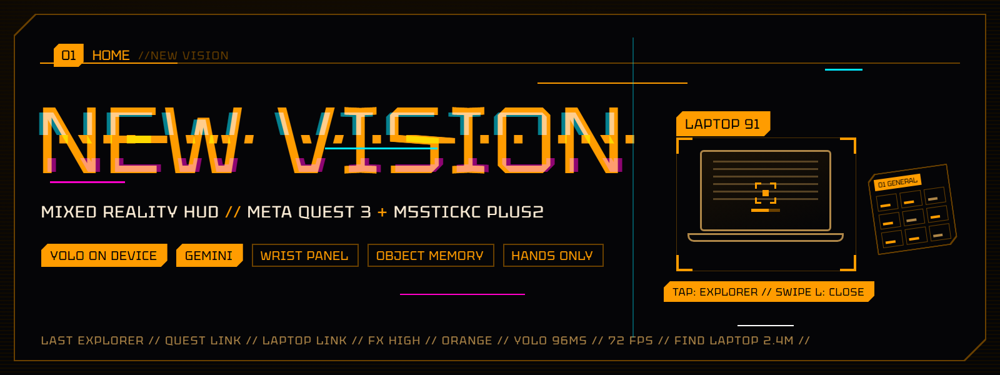
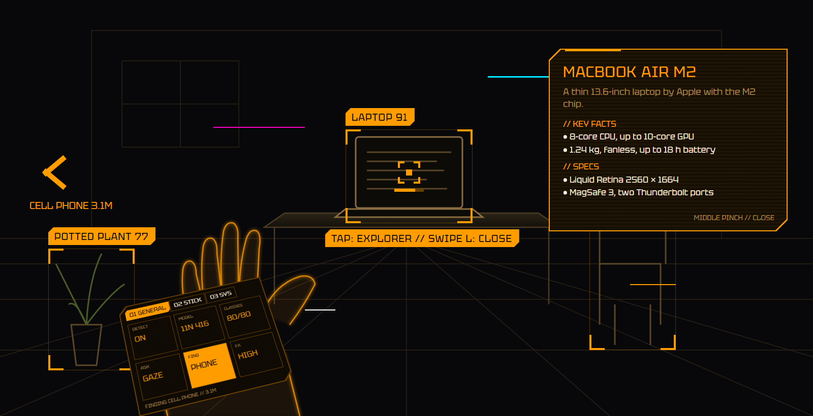
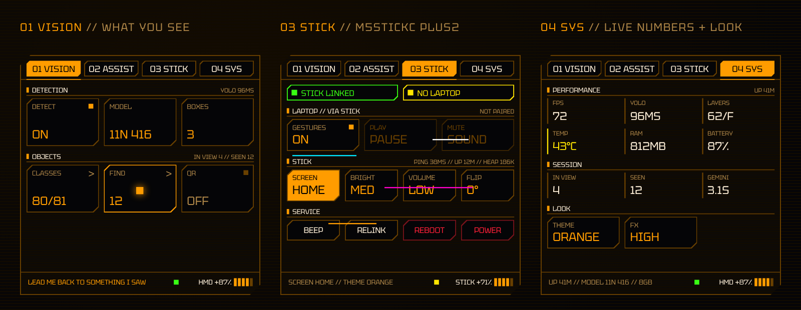
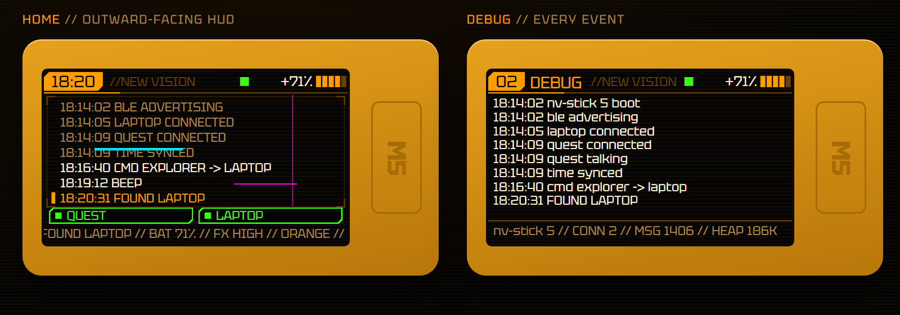
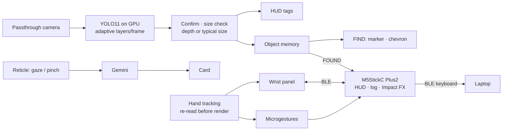

<p align="center">
  
</p>

<p align="center">
  
  
  
  
  
  
  
</p>

<p align="center">
  <a href="#01--what-it-is">What it is</a> ·
  <a href="#02--features">Features</a> ·
  <a href="#03--controls">Controls</a> ·
  <a href="#04--getting-started">Getting started</a> ·
  <a href="#05--the-stick">The stick</a> ·
  <a href="#06--under-the-hood">Under the hood</a> ·
  <a href="#07--troubleshooting">Troubleshooting</a>
</p>

## 01 // What it is

**New Vision** turns a Meta Quest 3 into a heads-up display for the real world. Through passthrough it sees what you
see, names it, remembers where it was, and answers questions about it. It is driven only by your hands: a control
panel lives on your left forearm, and an **M5StickC Plus2 clipped to the headset** shows its own outward-facing HUD
and types on your laptop over Bluetooth.

Everything you see wears one look: a black-glass, single-accent **cyberdeck** interface with cut corners, HUD
brackets, the Tektur typeface and glitches when you move fast. It is the same visual language as
[Vartovyi](https://github.com/Skerpsh/vartovyi), and the stick and the headset always share the same theme.

<p align="center">
  
  <br><sub>Concept art of the view through the headset (the passthrough image itself can't be captured in a screenshot).</sub>
</p>

## 02 // Features

### ▣ Detection: on the headset, no network needed

- **YOLO11 on the Quest GPU** through Unity Inference Engine: about **10 updates per second**, adaptive so the
  headset keeps a steady 72 FPS.
- **Five models, switchable live** from the panel: YOLO11n / YOLO11s at 320 or 416 px, and YOLO-World with an extra class.
- **Pick the classes**: all 80 COCO classes, page by page, with ALL / NONE / HOME presets. Remembered between launches.
- **Few false positives**: a tag appears only after several detections in a row, and objects whose real size
  (measured with depth) is impossible for their class are dropped.
- **Far away too**: beyond the depth sensor, objects are placed by their typical size, up to 60 m.
- **Calm overlay**: HUD corners and a cut-corner tag (`LAPTOP 91`) for the few most confident objects only.

### ◈ What is this?: Gemini about anything you look at

- **Look for 2 s or pinch**: the reticle (HUD brackets with a dwell meter) sends a crop around that spot to Gemini.
- **Any object**, not just the 80 classes: a plant species, a gadget model, a landmark. The answer streams into a
  floating card with a title, a one-line summary and `// SECTIONS` of facts.
- **QR codes and barcodes**: links open with a preview, Wi-Fi codes connect, product barcodes go to Gemini.

### ⌖ Object memory: "where did I leave it?"

- While you walk around, New Vision **remembers where each kind of object was seen** (a few spots per class).
- **GENERAL › FIND** lists them by age and distance. Tap one: brackets mark the spot, a **chevron at the edge of your
  view** points the way when it's behind you, and when the detector sees it again the marker turns green,
  `FOUND` pops up and **the stick beeps**.

### ▤ The wrist panel: the only control surface

<p align="center"></p>

Turn the inside of your left wrist towards your face and the panel opens on your forearm like an old monitor
switching on. Poke its tiles with your right index fingertip. It is fixed to your arm, stays smooth while you walk,
and glitches when you flick your hand.

| Tab | What's there |
|---|---|
| **01 GENERAL** | detection on/off, model, classes, boxes shown, Gemini by gaze or pinch, QR reader, laptop gestures, Capri, theme (6 colours), glitch FX level, FIND |
| **02 STICK** | headset and laptop link, laptop shortcuts, beep, the stick's screen page, brightness, volume, screen flip, reconnect, reboot, power off |
| **03 SYS** | live numbers: FPS, detection time, layers per frame, objects in view, memory, Gemini latency, temperature, RAM, GPU, batteries, stick ping |

The header always shows the battery of what the tab is about: the headset on GENERAL and SYS, the stick on STICK.

### ⌁ M5StickC Plus2: a second screen and a Bluetooth bridge

<p align="center"></p>

- **Mounted on the headset**, facing out: people around you see a live HUD with a clock, the event log, link pills
  and a ticker. Shaking your head shakes and tears the picture (Impact FX).
- **One Bluetooth LE peripheral, two links**: a **keyboard for your laptop** and a command channel for the headset.
- **Laptop by microgestures**: look at the laptop, then **tap your thumb on your index finger** → Explorer (Win+E),
  **swipe left** → close the window (Alt+F4).
- Its buttons are deliberately unused: everything is controlled from the wrist panel.

### ◇ The rest

- **Hands drawn as a faint outline** in the theme colour, like the Quest's own.
- **Capri**, a 2D companion who floats in your room, comes when called from the panel *(her artwork is not part of
  this repository, see [License](#09--license))*.
- **Walk around freely**: the boundary is hidden while passthrough is on.

## 03 // Controls

No controllers anywhere: the app runs in hands-only mode.

| Gesture | Where | Does |
|---|---|---|
| Inside of the left wrist to your face | anywhere | opens the panel; turn it away to close |
| Poke with the right index fingertip | panel | presses a tile (REBOOT, POWER OFF and CLEAR ask for a second press) |
| Look at something for 2 s | anywhere | "What is this?" (can be switched to pinch-only: GENERAL › ASK) |
| Index pinch | anywhere | "What is this?" right away; on a card: its action (open link, connect to Wi-Fi) |
| Middle-finger pinch | card open | closes the card |
| Thumb tap on the index finger | looking at the laptop | Win+E on the laptop |
| Thumb swipe left | looking at the laptop | Alt+F4 on the laptop |

## 04 // Getting started

### Requirements

| | |
|---|---|
| Headset | Meta Quest 3 or 3S, Horizon OS v74+, [developer mode](https://developers.meta.com/horizon/documentation/native/android/mobile-device-setup/) on |
| Unity | **6000.0.66f2** with *Android Build Support* (OpenJDK, Android SDK & NDK) |
| Git | [Git LFS](https://git-lfs.com/): the models are stored in LFS |
| "What is this?" | internet on the headset and a free [Gemini API key](https://aistudio.google.com/apikey) |
| The stick *(optional)* | M5StickC Plus2, [PlatformIO](https://platformio.org/), a laptop with Bluetooth |

### The app

1. **Clone with LFS**: `git lfs install`, then clone. The files in
   `Assets/PassthroughCameraApiSamples/MultiObjectDetection/SentisInference/Model/` must be megabytes, not ~130-byte
   pointers (otherwise `git lfs pull`).
2. **Open** the folder in Unity Hub, switch to **Android** in *File → Build Profiles*.
3. Run **New Vision → Apply App Settings** and **New Vision → Convert Models**.
4. Connect the headset and **Build And Run**. Without the editor:
   ```powershell
   Unity.exe -batchmode -quit -projectPath . -buildTarget Android `
     -executeMethod NewVision.Editor.NewVisionBuild.BuildAndroid      # -> Builds/NewVision.apk
   adb install -r Builds/NewVision.apk
   ```
5. In the headset allow **camera**, **spatial data** and **nearby devices** (Bluetooth, for the stick).
6. *Optional:* the Gemini key. Save it as `gemini_api_key.txt` **outside the repository** and copy it to the headset:
   ```bash
   adb push gemini_api_key.txt /sdcard/Android/data/com.newvision.app/files/gemini_api_key.txt
   ```
   It lives only on the headset: never in the APK, never in git. Check a key from the PC with
   `python Tools/test_gemini.py path/to/gemini_api_key.txt`.

> [!NOTE]
> **Privacy:** nothing leaves the headset unless you ask. For each "What is this?" a 512×512 crop of the camera image
> goes to Google; the last one is kept as `files/last_lookup.jpg` so you can see exactly what was sent.

## 05 // The stick

1. **Flash it** (USB-C cable with data):
   ```bash
   cd Firmware/M5Stick
   pio run -t upload
   ```
2. **Pair the laptop**: Bluetooth → add device → **New Vision Stick**. The stick shows `LAPTOP` in green.
3. **Mount it on the headset**, screen out. It can be powered from the headset's USB-C port (it only charges there:
   data over that cable doesn't work, the link is Bluetooth).
4. Start New Vision: it finds the stick by itself, sends it the time and the theme, and keeps the link up.
   If the picture is upside down: **STICK › FLIP**.

<details>
<summary>Protocol (Bluetooth LE, Nordic UART service; the same text commands work over USB serial at 115200)</summary>

| Command | Reply | |
|---|---|---|
| `NV?` | `NVSTICK bt=0\|1` | handshake; `bt` = laptop keyboard connected |
| `STATUS` | `STATUS bt= bat= chg= vol= bri= scr= th= fx= clk= rot= up= heap=` | polled every second |
| `CMD explorer` / `CMD close` | `OK …` / `ERR notpaired` | Win+E / Alt+F4 on the laptop |
| `SET vol\|bri <0..255>` | `OK …` | buzzer volume, screen brightness |
| `SET scr home\|debug\|off` | `OK scr` | screen page |
| `SET theme <0..5>` / `SET fx <0..2>` / `SET rot 0\|1` | `OK …` | look, Impact FX level, 180° flip |
| `TIME <unix> <utc offset min>` | `OK time` | clock and log timestamps |
| `LOG <text>` | `OK log` | an event for the stick's log |
| `BEEP` / `REBOOT` / `OFF` | `OK …` | |

Settings survive a reboot (NVS).
</details>

## 06 // Under the hood



### Detection models

Measured on Quest 3 (GPU, time per inference including letterboxing):

| Model | Input | Time | Notes |
|---|---|---|---|
| `yolo11n_320` | 320 | ~89 ms | fastest |
| **`yolo11n_416`** | 416 | **~96 ms** | **default**: sees farther at almost the same speed |
| `yolo11s_320` | 320 | ~167 ms | more accurate |
| `yolo11s_416` | 416 | ~193 ms | most accurate |
| `yoloworld_s_416` | 416 | ~200 ms | YOLO-World with the 80 classes + one custom class |

Add one with `python Tools/export_model.py yolo11m 416` (or your own `best.pt`), then **New Vision → Convert Models**.

### Codebase graph

[`graphify-out/`](graphify-out/) holds a knowledge graph of the code made with [graphify](https://github.com/Graphify-Labs/graphify):
open **`graphify-out/graph.html`** in a browser to explore how the scripts, the Java plugins, the shaders and the
firmware connect, or read **[`GRAPH_REPORT.md`](graphify-out/GRAPH_REPORT.md)** for the hubs and surprising links.
It was built offline (code only, nothing sent anywhere). After code changes:

```bash
pip install graphifyy
graphify update .
```

### Developer tools

| | |
|---|---|
| `Tools/quest_logs.ps1` | headset logs over Wi-Fi: `-Setup` once per headset reboot (on the cable), then `-Follow` / `-All` |
| `Assets/NewVision/Editor/NewVisionBuild.cs` | command-line APK build |
| `docs/art/render.ps1` | re-renders the README pictures from `docs/art/*.html` |
| `Tools/export_model.py`, `Tools/test_gemini.py`, `Tools/make_icon.py` | models, Gemini key check, app icon |

### Project structure

```
Assets/NewVision/                      editor menu, batch build, app icon
  Resources/NewVision/                 Tektur font (OFL), UIGlitch and HandRim shaders
Assets/Plugins/Android/
  NewVisionBleLink.java                Bluetooth LE link to the stick
  NewVisionWebView.java                in-app browser (work in progress)
Assets/PassthroughCameraApiSamples/MultiObjectDetection/
  Style/Scripts/                       NvStyle (themes, cut corners, font), NvGlitch, NvBrackets, HandOutline
  Stick/Scripts/                       WristPanel, StickClient, HandTracker, LaptopGestures, NewVisionControls
  Memory/Scripts/ObjectMemory.cs       object memory and FIND guidance
  ObjectInfo/Scripts/                  "What is this?", Gemini client, QR / barcodes, link preview, Wi-Fi
  SentisInference/                     models, detection, ClassFilter, tags
  Companion/                           Capri (shader under PolyForm Noncommercial, artwork not included)
  Browser/                             in-app browser (work in progress)
Firmware/M5Stick/                      stick firmware (PlatformIO), Tektur bitmap fonts (OFL)
graphify-out/                          codebase knowledge graph
docs/                                  README pictures and their sources (docs/art), Meta's original README
Tools/                                 model export, Gemini key check, icon, logs over Wi-Fi
```

## 07 // Troubleshooting

| Problem | Fix |
|---|---|
| The panel doesn't open | turn the *inside* of the left wrist towards your face, with the hand in view; the hand must be tracked with high confidence |
| STICK tab: `SCANNING` forever | the stick is off or out of range, or **nearby devices** wasn't allowed (STICK › LINK RESET asks again) |
| `NOT PAIRED` at the laptop | pair **New Vision Stick** in the laptop's Bluetooth settings (after re-flashing: remove it and pair again) |
| The stick's clock shows `--:--` | New Vision isn't running; the stick gets the time from the headset |
| Card says **Gemini API key missing** / **429 quota** | push the key file; on 429 wait a minute or enable billing in AI Studio |
| Models fail to load | LFS pointers instead of files: `git lfs pull` |
| Build: `not enough space` / Burst `AccessViolationException` | free 20+ GB, close Unity, delete `Library/Bee` and `Library/BurstCache` |
| See what's going on | `.\Tools\quest_logs.ps1 -Follow`, or SYS tab and the stick's DEBUG page |

> [!WARNING]
> **Outdoors: never leave the headset with its lenses facing the sun**, not even for seconds, it burns the displays.
> Don't use it near traffic: passthrough has latency and a narrower field of view.

## 08 // Credits

Based on Meta's [Unity-PassthroughCameraApiSamples](https://github.com/oculus-samples/Unity-PassthroughCameraApiSamples)
(`MultiObjectDetection`) by **Kyrylo Kuzyk**, **Jordi Ramon** and the Meta Reality Labs team; their original README is
in [docs/META_SAMPLE_README.md](docs/META_SAMPLE_README.md).

- Look, Impact FX and the stick's drawing code after [Vartovyi](https://github.com/Skerpsh/vartovyi)
- [Tektur](https://fonts.google.com/specimen/Tektur) typeface (SIL Open Font License)
- [Ultralytics YOLO11](https://github.com/ultralytics/ultralytics) · [Unity Inference Engine](https://docs.unity3d.com/Packages/com.unity.ai.inference@latest) · [Google Gemini API](https://ai.google.dev/)
- [NimBLE-Arduino](https://github.com/h2zero/NimBLE-Arduino) · [M5Unified](https://github.com/m5stack/M5Unified)
- Capri's shader is a port of [capri-desktop](https://github.com/mochiiwuff/capri-desktop)
- [graphify](https://github.com/Graphify-Labs/graphify) for the codebase graph · object classes from [COCO](https://cocodataset.org/)

## 09 // License

| Component | License |
|---|---|
| New Vision's own code and assets (`SPDX-License-Identifier: AGPL-3.0-only`, `Assets/NewVision/` scripts and shaders, `Tools/`, `Firmware/M5Stick/src`, the README pictures in `docs/` and `docs/art/`) | [AGPL-3.0](LICENSE) |
| Parts adapted from Vartovyi (marked in the files) | MIT |
| Tektur font (`Tektur.ttf`, `Firmware/M5Stick/fonts/*.vlw`) | [SIL OFL 1.1](Assets/NewVision/Resources/NewVision/Tektur-OFL.txt) |
| YOLO11 models (`yolo11*`, `yoloworld*`) by Ultralytics | [AGPL-3.0](LICENSE) |
| Capri shader (`Companion/Resources/NewVisionCapri.shader`) | PolyForm Noncommercial 1.0.0 (Required Notice in the file); her artwork is **not** included and belongs to its rights holders |
| Meta's sample code and assets, including the modified files | [Oculus SDK License](LICENSE.txt) and, where marked, [MIT](Assets/PassthroughCameraApiSamples/LICENSE.txt) |
| Meta's original YOLOv9 model | [MIT](https://github.com/MultimediaTechLab/YOLO/blob/main/LICENSE) |
| Meta XR SDK, Unity packages, NimBLE, M5Unified | their own licenses (fetched by the package managers, not included) |

Use of the Gemini API is subject to Google's [Gemini API Terms of Service](https://ai.google.dev/gemini-api/terms).

> This is not legal advice. AGPL components next to code under the Oculus SDK License, a noncommercial shader and
> Ultralytics models (commercial use needs an [Ultralytics Enterprise License](https://www.ultralytics.com/license))
> mean: check the terms before distributing builds.
